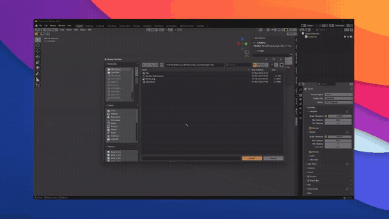

# Mine2Blend

> 把《我的世界》投影一键导入 Blender 的玩家工具


**Mine2Blend** 是面向 MC 玩家、动画师和教程创作者的 Blender 插件，用于把《我的世界》建筑投影直接导入 Blender，自动还原方块几何与材质，方便做渲染、动画和教程。

插件内置一套离线转换器，**无需手动安装 Node.js、也不依赖任何在线服务或服务器**——选中投影文件即可在本机完成转换并导入。

> ⚠️ 当前为 **0.5.12 内测版**，仅提供 Windows 10 / 11 x64 运行时，欢迎在 Issues 反馈问题。



> 🎬 演示：选中 `.litematic` / `.schem` 投影文件，一键导入 Blender 并自动还原方块几何与材质。

---

## ✨ 功能特性

- **多格式导入**：支持 `.litematic` 与 Sponge `.schem`（v2 / v3）两种主流投影格式
- **离线转换**：内置 Windows x64 转换器 runtime，导入全程在本机完成，无需联网、无需配置环境
- **材质还原**：自动处理贴图采样、透明、玻璃、水、植物裁切与 tint 染色，叶子 / 草类缺色时有默认兜底
- **多建筑共存**：不同建筑各自独立子集合、可自动并排，导入新建筑不会覆盖已导入的
- **投影管理面板**：已导入投影一行一个，可一键隐藏 / 删除 / 清空
- **诊断信息**：方块数、尺寸、材质数、面数、耗时、性能提示、材质审计一目了然
- **网站快捷入口**：一键打开 MCBlock 建筑库、网站在线编辑器和说明页

## 🧱 支持的格式

| 格式 | 状态 |
|------|------|
| `.litematic`（Litematica） | ✅ 已支持 |
| `.schem`（Sponge v2 / v3） | ✅ 已支持 |
| `.schematic`（旧版 MCEdit，数字方块 ID） | ⛔ 暂不支持 |
| `.nbt`（结构方块） | ⛔ 暂不支持 |

## 💻 系统要求

- **操作系统**：Windows 10 / 11 **x64**（暂未提供 macOS / Linux runtime）
- **Blender**：4.2 LTS 或更高（已在 5.1.2 实机验收）

## 📦 安装（玩家）

1. 在本仓库 [Releases](https://github.com/CAT-YC/Mine2Blend/releases) 页面下载最新的 `Mine2Blend.zip`（约 37 MB，内含转换器 runtime）。
2. 打开 Blender，进入 `Edit > Preferences > Get Extensions`（或 `Add-ons > Install from Disk`）。
3. 选择下载的 `Mine2Blend.zip` 安装并启用 **Mine2Blend**。
4. 在 `3D 视图 > 侧栏（N 键）> MCBlock` 找到插件面板。
5. 在「导入投影」中选择 `.litematic` / `.schem` 文件，点击导入。

> 💡 GitHub 仓库里的源码**不含**转换器运行时（`node.exe` / `node_modules`），所以请从 Releases 下载打包好的 `Mine2Blend.zip` 安装，而不是直接 clone 源码安装。

## 🛠️ 从源码构建（开发者）

本仓库为**纯源码仓**，刻意不收录第三方运行时二进制（`node.exe` 约 67 MB + `node_modules` 约 26 MB），以保持仓库轻量。构建可运行的插件包需要先补齐运行时：

1. clone 本仓库。
2. 进入转换器目录，按锁文件还原依赖，并放入一个 Windows x64 的 Node 运行时：
   ```bash
   cd resources/converter/win-x64
   npm ci          # 依据 package-lock.json 还原 node_modules
   # 再放入一个 Windows x64 的 node.exe 到本目录
   ```
3. 回到仓库根，运行打包脚本：
   ```bash
   python build_zip.py
   ```
   产物为 `dist/Mine2Blend.zip`，内部顶层会自动包成 `mcblock_mine2blend/` 包目录（Blender 安装所需），并通过结构自检。

> 📌 源码在仓库根是扁平铺开的，方便浏览；但 Blender add-on 安装包要求顶层是 `mcblock_mine2blend/` 包目录，因此请**用 `build_zip.py` 打包**，不要直接把仓库根压成 zip 安装。

### 仓库结构

```text
Mine2Blend/                          # 仓库根 = 插件源码（扁平）
├── README.md
├── .gitignore
├── build_zip.py                     # 打包脚本（自动包成 mcblock_mine2blend/ 安装包）
├── blender_manifest.toml            # 扩展清单（Blender 4.2+）
├── __init__.py
├── preferences.py
├── properties.py
├── core/                            # 转换桥接、材质、导入、诊断
├── operators/                       # 导入 / 材质 / 网站 / 诊断算子
├── panels/                          # N 面板 UI
└── resources/converter/win-x64/
    ├── src/batch-obj-export.mjs     # 转换器源码
    ├── package.json / package-lock.json
    ├── mcblock-litematic-converter.cmd
    └── assets/mcmeta/               # 方块定义 / 模型 / 贴图图集
    #   node.exe 与 node_modules 不在 git 中，构建时按上面步骤补齐
```

## 🌐 相关链接

- 插件说明页：<https://mcblock.top/blender>
- MCBlock 建筑库与网站在线编辑器：<https://mcblock.top>

## 📄 许可

本插件以 **GPL-3.0-or-later** 许可发布，版权 © 2026 MCBlock。

插件不包含《我的世界》游戏本体；`assets/mcmeta/` 下的方块定义与贴图数据仅用于在本机离线还原投影的几何与材质。Minecraft 是 Mojang Studios 的商标，本项目与 Mojang、Microsoft 无隶属关系。

## 0.5.4 本地开发候选（未发布）

本地源码已接入透明接触局部裁切、植被双面UV和独立发光贴图，区分炼药锅水面与锅身，修正浮冰/蓝冰透明分类并清理零面积面。同名重导先完成新模型校验再替换，失败保留原模型。

几何修复需要重新导入投影，已有 `.blend` 不会因“修复材质”自动重建网格。新OBJ旁的同名 `.surfaces.json` 应与OBJ一同保留，旧OBJ仍兼容。当前0.5.4仅为本地候选，未更新公开安装包或Release；本轮实际环境为Blender5.1.2，4.2设备和用户工程仍待验收。

包内 `tests/blender_projection_safety.py` 可在独立Blender后台进程中验证真实ZIP、两种投影格式、失败回滚及多投影清理；参数见文件头。

## 0.5.5 本地开发候选（未发布）

旗帜底纹与图案按顺序合成独立布料贴图，避免多层透明几何耗尽Cycles透明反弹而发黑；保留正反UV、染色、旗杆和朝向。导入时内嵌新布料图，重导清缓存后仍可保存重开，不改用户场景反弹参数。

需要安装新插件后重新导入投影。当前仅本地候选，已提供的0.5.4安装包保持不变；用户原工程与Blender4.2设备待验，未更新网站或Release。上面的0.5.4候选段落为当时的开发记录，发布状态以网站实际版本为准。

## 0.5.6 本地候选更新

- 按实际接触面与贴图不透明区域裁切玻璃，修复海晶灯、竹块、下界疣块以及墙、栅栏、门、活板门、雪层等同类接缝。
- 保留未遮挡的玻璃、树叶/活板门等贴图孔洞和对应UV；不同颜色玻璃、水与玻璃等不同透明介质保留边界。
- 保持邻块几何及双面薄片的原有顺序；不修改Cycles透明反弹参数。
- 极端碎片贴图、无效或非矩形UV保守保留原面，避免错误裁掉透明部分；不宣称覆盖所有自定义资源包。
- 更新后需重新导入投影重建网格；已有Blend只点“修复材质”不能修复旧接触面。
- 本轮提供本地候选安装包，公开下载及用户原工程验收另行确认。


## 0.5.6 发布

修复玻璃与海晶灯、竹块、墙、栅栏、门、活板门等方块衔接处的黑面与重叠，保留外露玻璃、贴图镂空和UV。

- 按实际面与贴图不透明区域裁切，保留不同透明材质的交界。
- 补充粘液块、蜂蜜块、水、冰与霜冰的衔接测试，保留内层结构。
- 保留旗帜图案合成、植被薄片正反UV及失败重导保护。

更新后请重启Blender并重新导入投影；“修复材质”不会重建已有网格。支持Windows x64，最低声明Blender4.2，本轮实际验证环境为Blender5.1.2/Cycles。

安装附件 `Mine2Blend.zip` 与网站 `Mine2Blend-0.5.6.zip` 完全相同，均为已验证安装包原字节：

- 大小：39,186,761字节
- SHA256：`e9bc1dbe81e7f516bc1d4626ac4e665855935e2e291c967281da18f04ff405a2`

## 0.5.7 灯笼光照本地候选

- 普通/灵魂灯笼含悬挂，按随包原版灯窗UV局部自发光，保留铁框、吊环、Alpha及镂空。
- 新增“灯笼光照”面板：自发光默认开启、强度4；辅助点光默认关闭，总功率12W/盏、默认最多32盏。应用于最近导入投影。
- 每盏采用四侧低功率点光，避免中心点光被不透明灯体挡住，保留正常阴影；功率和半径按导入比例换算。光源随参考对象变换，属于方块分区，支持更新、关闭、追加、同名替换和删除。
- 点光是可调辅助效果，不是Minecraft光照等级到瓦的物理映射；当前只支持随包原版两种灯笼，其他发光方块与任意自定义资源包不在此轮范围。
- 灯光由独立.lanterns.json与导入对象内数据驱动；旧OBJ/旧Blend需重新导入才能获取此数据。
- 保持0.5.6接触面裁切与几何，未修改玻璃外露面/孔洞、网格、UV或Cycles透明反弹参数。
- 本地验证环境为Blender5.1.2 Cycles；最低4.2设备与用户原工程仍需实际验收。此包未上架、未更新公开下载。

## 0.5.8 常用方块自发光本地候选

- 新增普通、灵魂、红石火把及挂墙变体；海晶灯、荧石、红石灯、菌光体、三色蛙明灯、末地烛、熔岩（含旧ID flowing_lava别名）。
- 火把仅亮头部，木柄不发光；末地烛排除底座；红石灯与红石火把按点亮状态和图集区域处理，亮灭共用材质仍能区分。
- 新增“方块自发光”面板，默认开启、倍率1，可更新最近导入投影。只接入发光输入，区域覆盖乘原贴图Alpha，不修改原网格、UV、透明与BSDF。
- 新发光方块不创建辅助点光；灯笼自发光和四侧辅助灯沿用0.5.7独立控制。
- 独立.emissives.json需重新导入生成；旧无该清单的OBJ保持原样。自发光参数与贴图会随新Blend保存，材质修复后恢复设置；共享mesh/材质隔离到目标投影。
- 保持随包原版静态首帧，视觉强度不等于Minecraft光照等级；未覆盖动态火焰、营火、蜡烛、所有发光植物或任意自定义资源包。
- 本地候选未发布，公开下载仍为0.5.6；仅在Blender5.1.2 Cycles验证，4.2设备、EEVEE与用户原工程待实际验收。

## 0.5.9 百科光源补齐本地候选

- 按 Minecraft Wiki 2026-11-02 光源表和单独页面核对；本版覆盖当前随包可渲染的106个Java光源方块ID（含颜色、挂墙、涂蜡和氧化变体），另保留旧熔岩ID和睁眼眼眸花原生发光层。
- 新增洞穴藤蔓头部/藤身的发光浆果、铜火把、17种蜡烛及蜡烛蛋糕、含水海泡菜、火/灵魂火与营火、熔炉族、铜灯族、红石矿、重生锚，以及光源清单内的低亮度方块。
- 状态分别处理：浆果berries、点燃lit、含水waterlogged、蜡烛/海泡菜数量、重生锚charges、铜灯氧化和试炼刷怪笼/宝库状态。不会把同材质的未点燃或未充能方块一起点亮。
- 局部像素掩码保留叶片、蜡身、炉壳和铜框；独立角点权重与原生双面发光层共同工作，保持原OBJ/MTL、UV、Alpha与玻璃接触裁切。
- 铜灯笼8种变体（含悬挂）加入独立“灯笼光照”，仍为每盏四侧辅助点光、默认关闭；其余新光源通过材质自发光照明，不额外生成点光。
- 请重新导入投影生成v2发光状态数据；旧v1清单和无清单OBJ继续兼容，已有Blend不会凭空获得新几何或状态。贴图和像素掩码内嵌，设置可保存并在材质修复后恢复。
- 保持原版贴图静态首帧，不模拟蜡烛/火把粒子。Wiki游戏光照等级与Cycles强度/瓦数分别记录，视觉预设可在面板调整。
- 明确边界：隐形light、末地传送门和末地折跃门还需要专用光源/表面渲染；6项基岩/教育版光源、缺少随包资源的实验冰晶不冒充已支持。完整逐项清单见docs/light-sources-20261102.md。
- 此包仅为本地候选，未公开发布或上架；本机验证为Blender5.1.2 Cycles，4.2设备、EEVEE、大型场景性能与用户原工程另验。

## 0.5.9 发布


新增方块自发光与灯笼辅助光，让投影导入后的灯火、浆果和发光材质更接近预期。

- 按Minecraft Wiki清单补齐当前随包可渲染的106个Java光源方块ID，包含火把及挂墙变体、发光浆果、蜡烛、营火、炉具、海泡菜、铜灯和铜灯笼等。
- 根据点燃、浆果、含水、充能与氧化状态处理发光；只点亮烛芯、浆果、炉口等区域，保留蜡身、叶片、炉壳、铜框与透明部分。
- 新增“方块自发光”调整；普通、灵魂和铜灯笼使用独立“灯笼光照”，可开启四侧辅助点光。辅助点光默认关闭，可调功率与数量上限。
- 发光贴图和局部掩码随Blend保存；关闭发光、修复材质、重新导入和多投影管理保持兼容。
- 保留0.5.6玻璃衔接修复，以及外露玻璃、镂空、粘液块和蜂蜜块内部结构、旗帜与植被薄片处理。

升级后请重启Blender并重新导入投影，生成新的光源状态数据；已有工程请先另存副本。“修复材质”不会重建旧网格或补出新的导出状态。

Windows 10/11 x64；最低声明Blender4.2。本次实际验证环境为Blender5.1.2/Cycles；4.2、EEVEE、任意自定义资源包和大型场景性能仍待独立验证。
保持原版贴图静态首帧，不模拟火把/蜡烛粒子；隐形light、末地传送门、末地折跃门的专用渲染尚未实现。6项基岩/教育版光源和缺少资源的实验冰晶不在本版支持范围。完整清单见包内docs/light-sources-20261102.md。

官网继续免费获取。GitHub附件Mine2Blend.zip与官网Mine2Blend-0.5.9.zip使用已验证候选包原字节；包内“本地候选”文字保留为开发阶段记录，当前发布状态以本Release为准。

- 大小：39,238,833字节
- 文件：908条
- SHA256：c991999d1d714fb288d4cde080d196de934363cfb1a3ae8fc2d09f545db49ff1


## 0.5.11 发布

- 补齐海草、海带及含水方块的水体，保留主体材质、原方块数量与投影文件。
- 修复水面、海草等序列帧贴图边缘串色；Blender 仍按随包资源显示静态首帧。
- 修正含水空墙、气泡柱透明度，以及按方块/方块实体分区导入时缺失的水面。
- 补齐末地水晶导入，改进铜栅栏等镂空方块与玻璃的衔接。
- 保留旗帜合成、玻璃与镂空接触面、灯笼及方块状态发光功能。

Windows x64 完整安装包：[Mine2Blend.zip](https://github.com/CAT-YC/Mine2Blend/releases/download/v0.5.11/Mine2Blend.zip)。网站下载的 `Mine2Blend-0.5.11.zip` 与该附件字节一致。

升级后请重启 Blender 并重新导入投影；已有 `.blend` 不会自动重建，手动修改过的工程请先另存副本。当前实际验证为 Blender 5.1.2/Cycles；最低声明为 Blender 4.2 LTS，4.2 与 EEVEE 尚待验证。

## 0.5.12 发布

- 修复了 Blender 4.5.9 导入含营火的投影时出现的发光表面校验错误。
- 已在 Blender 4.5.9 LTS 和 5.1.2 验证普通营火与灵魂营火的点燃和熄灭状态。点燃时保留各自的自发光，熄灭时不自发光。
- 升级后请重启 Blender 并重新导入投影。

下载 Windows x64 完整安装包 Mine2Blend.zip，也可从 [MCBlock 官网](https://mcblock.top/blender) 下载。
